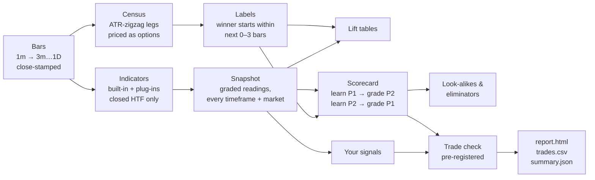

# Backtest Kit

**Honest options backtesting for discretionary traders — on your own machine, with your own indicators.**


Backtest Kit turns chart reading into measured, out-of-sample evidence. It rebuilds your
TradingView indicators in Python, finds every move that paid, learns which readings came before
them, and prices every trade as the **option** you would actually buy — then grades everything on a
stretch of time the model never saw. It runs locally, reads market data only, and is designed to be
driven in plain English through [Claude Code](https://claude.com/claude-code) as well as from the
command line.

```bash
uv run kit smoke     # the whole pipeline on bundled synthetic data — no account needed, about a minute
```

**See a complete run first:** [`examples/sample-study/`](examples/sample-study/) — HTML report, trade log and results.

---

## Contents

[Why another backtester](#why-another-backtester) ·
[What it does](#what-it-does) ·
[Quick start](#quick-start) ·
[Example output](#example-output) ·
[How it works](#how-it-works) ·
[Your own indicators and signals](#your-own-indicators-and-signals) ·
[Data sources](#data-sources) ·
[Working with Claude Code](#working-with-claude-code) ·
[Command reference](#command-reference) ·
[Validation](#validation) ·
[Status and limitations](#status-and-limitations) ·
[Contributing](#contributing) ·
[License](#license) ·
[Disclaimer](#disclaimer)

## Why another backtester

Chart-platform strategy testers answer a different question from the one an options trader asks.

| The usual backtest | What goes wrong | What Backtest Kit does instead |
|---|---|---|
| Trades the stock | No premium, decay, IV or expiry: a 0.5% move is 5x on a 0DTE and nothing on a monthly | Prices every trade as an at-the-money option with the expiry fixed **at entry** |
| Higher timeframes repaint | `request.security(..., lookahead_on)` shows the finished 4h / daily bar on history | Higher timeframes come only from bars that had **closed**; a test scrambles the future to prove it |
| One chart, picked by eye | A few remembered cases, mostly winners | Every bar of every ticker; winners are found by rule, not memory |
| Tuned and graded on the same bars | Any setting looks good on the data it was tuned on | Learn on one half of time, grade on the other, then swap |
| Fixed targets, stops and hold times | Not how a momentum trader exits | Exits that follow momentum turning, plus an "exhaustion" read — compared on the same entries |

## What it does

**Data**
- Downloads 1-minute and daily bars from a **free Alpaca account** or the **TradeStation API** (optional: Databento), resumes after interruption, respects rate limits, and builds 3m / 15m / 1h / 4h / 1D bars.
- Imports TradingView "Export chart data" files and **matches your Python indicators against your chart, bar by bar**.
- Records live option chains daily so real-quote history accumulates going forward.

**Indicators**
- A plug-in interface for **your own indicators**, with a Pine-faithful library of built-ins (`ema`, `sma`, `rma`, `wma`, `rsi`, `stoch`, `atr`, `macd`, `bb`, `vwap`, pivots, `barssince`, `valuewhen`, `supertrend`, …) and helpers that map each `request.security` pattern to a non-repainting equivalent.
- `kit check-indicator` **proves a plug-in never reads the future** (three cut points × prices raised, lowered and scrambled).
- Ships with Stochastic, RSI and MACD (TradingView default settings) and a worked Pine → Python example.

**Method** — a winners-first research pipeline
- **Census**: every swing leg (ATR zigzag, day-trade to multi-month sizes) priced as an option; 1x / 3x / 5x / 10x winners by horizon.
- **Graded snapshot** of every bar on every timeframe plus the market, joined strictly point-in-time.
- **Lift tables**, a **scorecard** (penalised logistic regression on quantile bins, cross-fitted across halves) with A/B/C grades, **look-alikes and eliminators**, and an **exhaustion** model for exits.
- **Signals**: describe a setup in one line; get entries per month, lift and follow-through per half.
- **Pre-registered trade check**: entries (grades or a signal) vs all bars, two exit rules, both halves; optional same-day variant.

**Outputs** — a one-page HTML report, a trade-by-trade CSV with exit reasons, and every table as JSON.

**Safety** — read-only by construction: requests pass a guard that allows market-data reads only;
order endpoints and trading scopes are refused, and a test fails the build if they appear in the
code. Secrets live in the macOS Keychain.

## Quick start

**Requirements:** macOS or Linux, [uv](https://docs.astral.sh/uv/) (`brew install uv`), git. uv installs Python 3.12 for you.

```bash
git clone <repository-url> backtest-kit
cd backtest-kit
uv sync                      # installs Python and dependencies (~30 s)
uv run kit doctor            # what is ready, what is missing, how to fix it
uv run kit smoke             # full pipeline on synthetic data; every line should say PASS
```

Get real data — one source is enough ([details](docs/data-sources.md)):

```bash
uv run kit login alpaca                        # free account; or: uv run kit login tradestation
uv run kit fetch --source alpaca --tickers SPY,QQQ,NVDA,AAPL,MSFT
```

Run a study:

```bash
uv run kit study new first-look                # creates studies/first-look/{study.toml, prereg.md}
#   edit prereg.md: idea, entry, exit, measure, pass mark — before you see any result
uv run kit study run first-look
uv run kit report first-look --open
```

**With Claude Code**, open it in an empty folder and paste:

> Clone `<repository-url>` into `~/Development/backtest-kit`, open it, and follow the "Fresh setup on a new Mac" steps in its CLAUDE.md. Tell me in plain words what passed and what still needs me.

## Example output

From [`examples/sample-study/`](examples/sample-study/), a run on the kit's **synthetic** dataset
(made-up tickers with one planted pattern: heavy volume before some up-moves). `kit report`:

```text
C_1x: held-out AUC 0.724 / 0.718 (0.5 = coin flip).
   Strongest readings that agree in both halves: h4_stoch_k -inf..6.5 (x1.24/x1.24); D_volume_x 1.44..inf (x1.25/x1.22);
   m15_volume_x 1.8..inf (x1.29/x1.2)

Trade check (pre-registered): entries signal volume_surge, trail 0.75 day-ATR, 246 trades in results/trades.csv.
   P1 signal volume_surge | momentum trail |   53 trades, median x1.88, doubled 43.4%, lost half 3.8%
   P1 all bars (baseline) | momentum trail | 4270 trades, median x0.73, doubled 14.4%, lost half 15.5%
   P2 signal volume_surge | momentum trail |   70 trades, median x2.2,  doubled 55.7%, lost half 2.9%
   P2 all bars (baseline) | momentum trail | 4510 trades, median x0.75, doubled 14.7%, lost half 16.3%
   Top 3 days carry 19.1% of these entries' profit; top 3 tickers 70.0%.

Your signals (lift = how much more often a winning option leg started right there):
      volume_surge P1:  56 entries (9.3/mo),  C_1x x3.0,  went our way first 95.5%
      volume_surge P2:  70 entries (12.0/mo), C_1x x3.53, went our way first 91.7%
   overbought_fade P1: 113 entries (18.8/mo), P_1x x2.37     <- held in one half only:
   overbought_fade P2: 134 entries (22.9/mo), P_1x x0.82        not a finding
```

`results/trades.csv`, one row per trade:

| ticker | half | entry_time | entry_price | expiry | premium | exit_time | exit_price | exit_reason | multiple | hold_bars |
|---|---|---|---|---|---|---|---|---|---|---|
| SYNA | P1 | 2025-06-06 13:30 | 70.82 | 2025-06-13 | 1.27 | 2025-06-12 14:30 | 75.82 | momentum trail | 3.94 | 29 |
| SYNA | P1 | 2025-06-20 15:30 | 71.16 | 2025-06-27 | 1.48 | 2025-06-25 10:30 | 78.34 | momentum trail | 4.89 | 16 |

The HTML report adds the winner census, option results per grade, decile lift, the readings that
agree in both halves, group-removal importance, look-alikes and eliminators, lift tables,
exhaustion, a distribution chart, and results by month and by ticker. Every output is described in
[docs/outputs.md](docs/outputs.md).

## How it works



Rules enforced in code rather than left to discipline:

- A reading at bar *t* uses only bars closed by *t*; higher timeframes join strictly before *t*.
- Labels may look forward (that is what a label is); readings never do — tests scramble future prices and require every past reading to stay identical.
- Every result is reported for **both halves** of time; grade cut-offs come from the learning half.
- The trade check runs only after `prereg.md` states the idea, entry, exit, measure and pass mark; editing it afterwards marks the result **exploratory**. An optional sealed holdout is logged when opened.
- Option expiry is chosen by a rule known at entry, never by where the move ended. Trades still open at the end are reported as censored.

The full method, definitions and parameters: [docs/method.md](docs/method.md).

## Your own indicators and signals

**Indicators** are single Python files in `plugins/indicators/` (or in any folder you list in
`kit.toml` as `plugin_dirs`, so private tools can live in a separate private repository):

```python
from kit.ind import pine
from kit.plugin import Indicator

class RsiBands(Indicator):
    name = "rsi_bands"
    version = "RSI Bands v1"
    tv_columns = {"rb_rsi": ["RSI"]}                 # for a bar-by-bar match against TradingView

    def compute(self, bars, ctx):
        r = pine.rsi(bars.close, 21 if ctx.tf == "1D" else 14)
        daily = ctx.htf_prev("1D", lambda d: {"rsi": pine.rsi(d.close, 14)})["rsi"]  # Pine: expr[1] + lookahead_on
        return {"rb_rsi": r, "rb_daily_rsi": daily}

    def readings(self, out, bars):                   # what a study learns from
        r = out["rb_rsi"].to_numpy(float)
        return {"rb_rsi": r, "RB_STATE": self.zones(r, [30, 70], ["oversold", "middle", "overbought"])}
```

```bash
uv run kit new-indicator my_tool --from-pine my_tool.pine   # scaffold (Claude Code does the translation)
uv run kit check-indicator my_tool                          # must print SAFE TO STUDY WITH
uv run kit match-check export.csv --indicator my_tool       # matches your TradingView chart?
```

**Signals** are usually one line in a study's `study.toml`:

```toml
[signals.stoch_turn_up]
side = "C"
when = "h1_STOCH_STATE == '<20 rising' and h4_MACD_STATE.str.startswith('bull')"
```

A worked Pine → Python example ships in [`plugins/`](plugins/). The Pine mapping table, rules and
signal reference: [docs/extending.md](docs/extending.md).

## Data sources

| Source | Cost | 1-minute stock history | Best for |
|---|---|---|---|
| **Alpaca Market Data (Basic)** | Free account, no deposit | All-exchange bars **since 2016** (requests must end ≥15 min ago); 200 calls/min | Years of minute bars at no cost |
| **TradeStation API** | Free API; funded account required | ≤ 57,600 bars per request; depth depends on account | Traders who already use TradeStation |
| **Databento** *(optional)* | Pay as you go | US equities from 2023-03-28; full options tape (OPRA) from 2013 | Real historical option quotes |
| **TradingView export** | Plus plan or higher | What the chart shows (10K–40K bars) | Proving indicators match; quick imports |

No free source offers historical option bid/ask, which is why option prices are modelled by
default. Setup steps, the free sources evaluated and rejected, and account-specific limits to
confirm: [docs/data-sources.md](docs/data-sources.md).

## Working with Claude Code

The repository is built to be operated by Claude Code. `CLAUDE.md` holds the research rules and
setup steps, and `.claude/skills/` contains five step-by-step guides — **port a Pine indicator**,
**add a signal**, **run a study**, **check indicator match**, **explain a report**. Every command
has `--json` output for Claude and a plain-English summary for you.

> *"Port my Pine script ~/Downloads/my_tool.pine into the kit, prove it has no lookahead, and tell me what you couldn't port."*
>
> *"Add a signal: 1h stochastic turns up from under 20 while the daily MACD histogram is positive. Calls."*
>
> *"Explain the first-look report. What held in both halves, and what are the eliminators?"*

More: [docs/claude-code.md](docs/claude-code.md).

## Command reference

| Command | Purpose |
|---|---|
| `kit doctor` | Readiness check with a fix for every missing item |
| `kit smoke` | End-to-end self-test on synthetic data |
| `kit login alpaca \| tradestation` | Store API keys in the Keychain (TradeStation: browser sign-in) |
| `kit fetch [--source alpaca\|tradestation\|databento]` | Download bars; resumable |
| `kit build` | Rebuild 3m / 15m / 1h / 4h / 1D from downloaded bars |
| `kit snapshot-options` | Save today's option chains (real quotes, going forward) |
| `kit import-tv <csv>` · `kit match-check <csv>` | Load a TradingView export · compare indicators bar by bar |
| `kit indicators` · `kit check-indicator <name>` | List indicators · prove a plug-in has no lookahead |
| `kit new-indicator <name>` · `kit new-signal <name>` | Scaffold a plug-in |
| `kit columns [study]` | Everything a signal can reference, with example values |
| `kit census` | Swing legs priced as options; winners by horizon |
| `kit study new \| run <name>` | Create / run a study |
| `kit report <name> [--open]` | Plain-English results; open the HTML report |
| `kit examples` | Rebuild `examples/sample-study/` |
| `kit webhook-log` | Optional forward-test log of TradingView alerts (localhost only) |

All commands accept `--json`.

## Validation

`uv run pytest` runs the suite in about a minute. It includes:

- hand-worked values for the Pine built-ins, and the bundled indicators checked against independent textbook implementations;
- no-lookahead tests that scramble future prices on every timeframe and on the full per-bar table — and a deliberately repainting indicator that must fail them;
- `check-indicator` catching a plug-in that reads the next bar and one that uses an unfinished higher-timeframe bar;
- read-only guards for every data source, and order-endpoint text banned from the code;
- the TradeStation and Alpaca clients against mock APIs (paging, throttling, resume after a crash);
- the full pipeline end to end, including recovery of a planted pattern on data the model never saw.

## Status and limitations

Version 1.0. Known limitations:

- **Option prices are modelled** (Black-Scholes, constant IV, no spread). Use results to rank ideas, not to size money, until real quotes are added.
- Studies use a **1-hour base timeframe**; daily legs are in the census, but a daily-base scorecard is not yet built.
- Regular trading hours and US equities only.
- The TradeStation and Alpaca clients are tested against mock APIs built from their documentation; account-specific limits are listed in [docs/data-sources.md](docs/data-sources.md#to-confirm-with-your-account).

## Contributing

Contributions are welcome — see [CONTRIBUTING.md](CONTRIBUTING.md). In short: `uv sync`,
`uv run pytest`, keep the read-only and no-lookahead guarantees intact, and add hand-checked tests
for anything numerical.

## License

[MIT](LICENSE). Only add indicators to this repository that you have the right to publish; keep
commercial or licensed ports in a private plug-in folder (see [docs/extending.md](docs/extending.md)).

## Disclaimer

Backtest Kit is research software. It is not investment advice, does not place trades, and makes
no claim that any result will repeat. Backtests — even careful ones — overstate what live trading
delivers, and modelled option prices ignore spreads and volatility changes. Verify on small size
before relying on anything.
