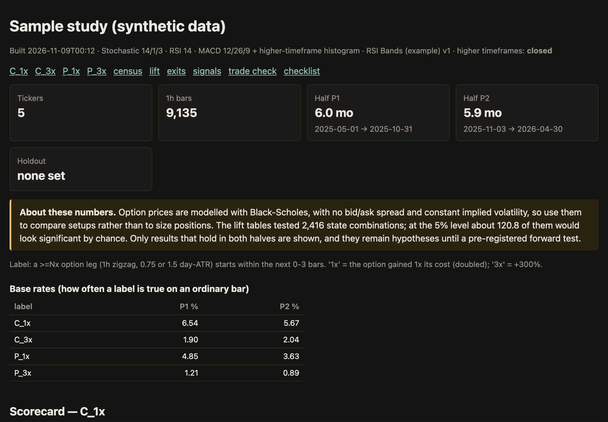
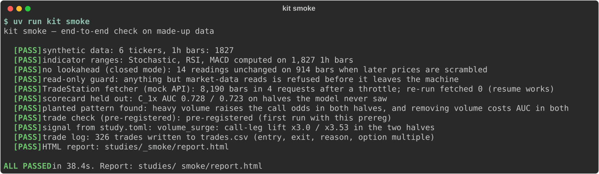
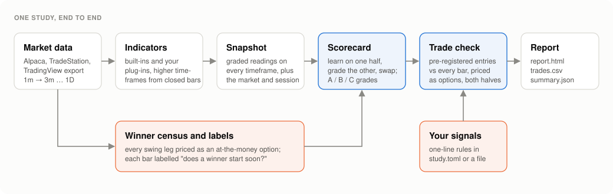
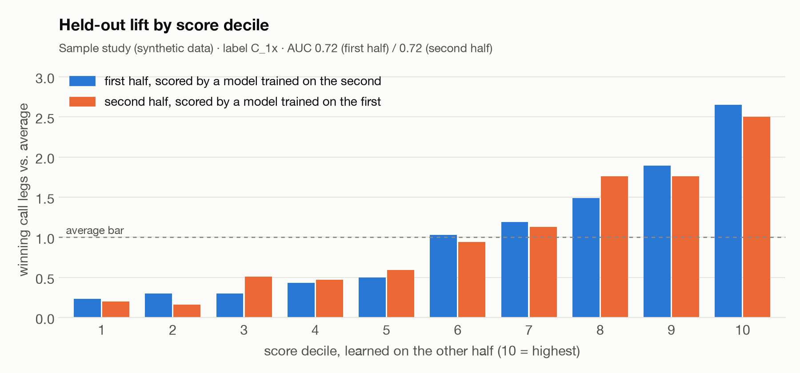
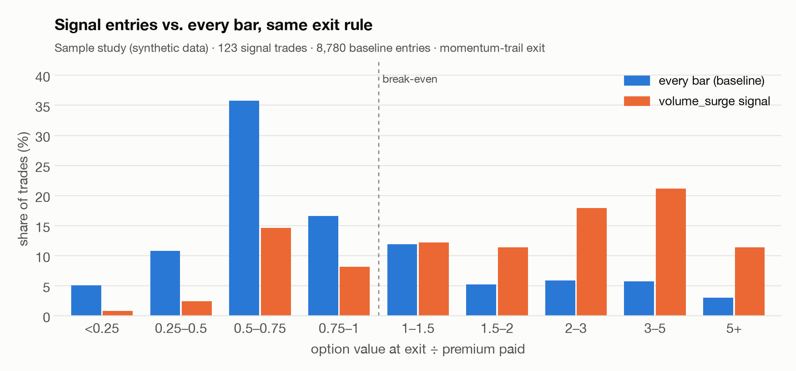
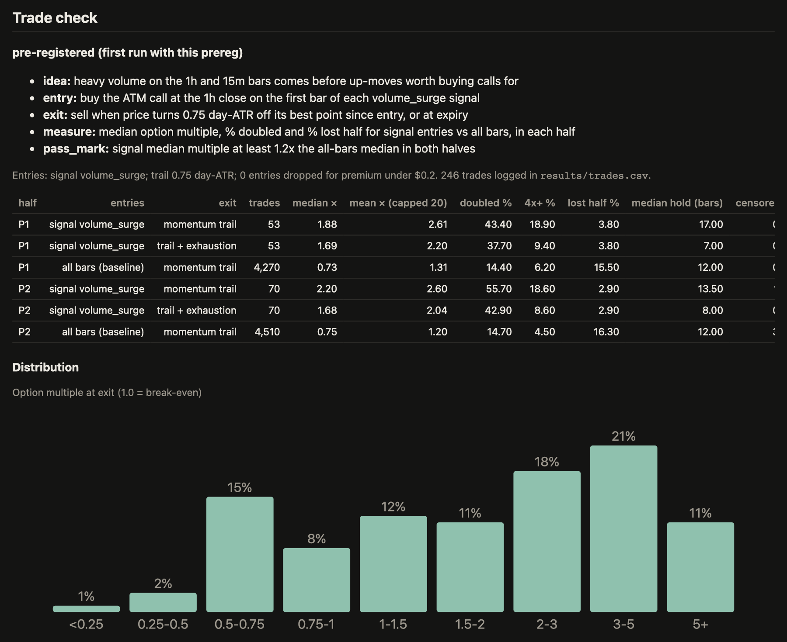

<p align="center">
  <picture>
    <source media="(prefers-color-scheme: dark)" srcset="docs/images/logo-dark.svg">
    
  </picture>
</p>

<p align="center">
  Test trading ideas against every bar of history, priced as the options you would actually trade.
</p>

<p align="center">
  
  
  
  
</p>

---

Backtest Kit is a research tool for discretionary options traders. You bring the indicators you
already watch on TradingView and a list of tickers. The kit rebuilds those indicators in Python,
finds every move in the history that would have paid on an option, learns which chart readings
tended to come before those moves, and checks the result on a stretch of time the model never
learned from. Trades are priced as at-the-money options with a realistic expiry rather than as
shares.

Everything runs on your own machine. The kit reads market data and never sends orders, and it was
built to be driven by [Claude Code](https://claude.com/claude-code) as comfortably as from the
command line: ask for a Pine script to be ported or a setup to be tested, and the repository
contains the guides Claude follows to do it.

<p align="center">
  
  <br><sub>The top of a study report. Every study produces one of these, plus a trade log and the raw tables.</sub>
</p>

## Installation

Backtest Kit needs [uv](https://docs.astral.sh/uv/) and git. uv installs the right Python for you.

```bash
brew install uv            # or see https://docs.astral.sh/uv/
git clone <repository-url> backtest-kit
cd backtest-kit
uv sync
```

Check the install with the self-test. It runs the whole pipeline on a bundled synthetic dataset
and needs no account or network access:

```bash
uv run kit smoke
```

<p align="center">
  
</p>

## Quick start

Download some history. Alpaca's free plan includes minute bars back to 2016; TradeStation works
too if you have API access.

```bash
uv run kit login alpaca
uv run kit fetch --source alpaca --tickers SPY,QQQ,NVDA,AAPL,MSFT
```

Create a study, write down what you expect before you look, and run it:

```bash
uv run kit study new first-look
$EDITOR studies/first-look/prereg.md      # the idea, the entry, the exit, and what would count as a pass
uv run kit study run first-look
uv run kit report first-look --open
```

`kit doctor` tells you what is set up and what is still missing at any point.

## How a study works

<p align="center">
  <picture>
    <source media="(prefers-color-scheme: dark)" srcset="docs/images/pipeline-dark.svg">
    
  </picture>
</p>

A study starts from the winners rather than from a rule. The kit walks each ticker's history with
an ATR zigzag and lists every swing that would have paid on an at-the-money option, from same-day
moves to multi-month trends. Each bar is then labelled by whether one of those winners started
shortly after it.

Next, every bar gets a snapshot of graded readings: where each indicator sat and which way it was
moving on the 3-minute, 15-minute, 1-hour, 4-hour and daily charts, how the market was behaving, and
where price sat relative to its averages and the prior day. Higher timeframes only ever contribute
bars that had already closed, so nothing a chart would have repainted leaks in.

A scorecard learns how much each reading shifts the odds of a winner. It is trained on one half of
the history and graded on the other, then the halves swap, so every grade comes from a model that
never saw that bar. The report shows which readings mattered in both halves, which ones mark setups
that tend to fail, and how the top grades performed.

Finally, the trade check runs your pre-registered entry and exit as option trades and compares them
with the same exit applied to every bar. A setup is only interesting if it beats that baseline in
both halves. The details are in [docs/method.md](docs/method.md).

## Example results

These come from the [sample study](examples/sample-study/), which runs on synthetic data with one
pattern planted in it: heavy volume before some up-moves. The kit finds that pattern on the half of
the data it did not train on, which is the point of the exercise.

<p align="center">
  <picture>
    <source media="(prefers-color-scheme: dark)" srcset="docs/images/decile-lift-dark.png">
    
  </picture>
</p>

Bars the scorecard ranked highest were about two and a half times as likely as an average bar to
come right before a winning call, and the ranking held up in both halves of the data.

<p align="center">
  <picture>
    <source media="(prefers-color-scheme: dark)" srcset="docs/images/trade-distribution-dark.png">
    
  </picture>
</p>

Trading the `volume_surge` signal with the same exit rule moves most outcomes to the right of
break-even. Entering on every bar loses money on the median trade, and that is the baseline any idea
has to beat. The report breaks this down by half, month and ticker and lists every trade:

<p align="center">
  
</p>

| ticker | entry | expiry | premium | exit | exit reason | multiple |
|---|---|---|---|---|---|---|
| SYNA | 2025-06-06 13:30 at 70.82 | 2025-06-13 | 1.27 | 2025-06-12 14:30 at 75.82 | momentum trail | 3.94 |
| SYNA | 2025-06-20 15:30 at 71.16 | 2025-06-27 | 1.48 | 2025-06-25 10:30 at 78.34 | momentum trail | 4.89 |

<sub>Rows from <a href="examples/sample-study/trades.csv"><code>trades.csv</code></a>. The tickers are made up.</sub>

## Bringing your own indicators

An indicator is a single Python file. Most of Pine Script's built-ins have a direct equivalent in
`kit.ind.pine`, and higher timeframes go through a helper that only ever returns closed bars:

```python
from kit.ind import pine
from kit.plugin import Indicator


class RsiBands(Indicator):
    name = "rsi_bands"
    version = "RSI Bands v1"
    tv_columns = {"rb_rsi": ["RSI"]}          # lets match-check compare against your TradingView export

    def compute(self, bars, ctx):
        rsi = pine.rsi(bars.close, 21 if ctx.tf == "1D" else 14)
        daily = ctx.htf_prev("1D", lambda d: {"rsi": pine.rsi(d.close, 14)})["rsi"]
        return {"rb_rsi": rsi, "rb_daily_rsi": daily}

    def readings(self, out, bars):            # what a study learns from
        rsi = out["rb_rsi"].to_numpy(float)
        return {"rb_rsi": rsi,
                "RB_STATE": self.zones(rsi, [30, 70], ["oversold", "middle", "overbought"])}
```

Two commands tell you whether you can trust it. `check-indicator` moves future prices around and
fails if anything in the past changes. `match-check` lines your values up against a TradingView
export of the same chart.

```bash
uv run kit check-indicator rsi_bands
uv run kit match-check ~/Downloads/NVDA_60.csv --indicator rsi_bands
```

Private or licensed indicators can live in a separate folder outside the repository; list it under
`plugin_dirs` in `kit.toml`. A complete Pine-to-Python example ships in [`plugins/`](plugins/), and
[docs/extending.md](docs/extending.md) has the full mapping table.

## Signals

A signal is an entry rule, usually written as one line in a study's settings:

```toml
[signals.stoch_turn_up]
side = "C"
when = "h1_STOCH_STATE == '<20 rising' and h4_MACD_STATE.str.startswith('bull')"
```

Each study reports how often a signal fired, how much more often a winner followed than on an
average bar, and how often price moved its way first, separately for each half of the data.
`kit columns` lists everything a signal can refer to.

## Data sources

| Source | Cost | Minute history | Notes |
|---|---|---|---|
| [Alpaca](https://alpaca.markets) | Free account | Since 2016 | All US exchanges; requests must end at least 15 minutes ago |
| [TradeStation](https://api.tradestation.com/docs) | Free with a funded account | Depends on the account | Up to 57,600 bars per request |
| [Databento](https://databento.com) | Pay as you go | Equities from 2023; options from 2013 | Optional; the route to real option quotes |
| TradingView | Plus plan or higher | What the chart shows | Used to check indicators, not as the main source |

None of the free sources offer historical option quotes, so option prices are modelled with
Black-Scholes until you add real quotes. See [docs/data-sources.md](docs/data-sources.md) for setup
steps and the limits worth confirming with your own account.

## Working with Claude Code

Open Claude Code in the repository and describe what you want:

> Port my Pine script ~/Downloads/my_tool.pine into the kit and tell me what you couldn't port.

> Add a signal for calls: the 1h stochastic turns up from under 20 while the daily MACD histogram is positive.

> Walk me through the first-look report. What held up in both halves?

`CLAUDE.md` carries the research rules and setup steps, and `.claude/skills/` has step-by-step
guides for porting indicators, adding signals, running studies, checking indicator matches and
explaining reports. Every command also takes `--json`. More in [docs/claude-code.md](docs/claude-code.md).

## Commands

| Command | |
|---|---|
| `kit doctor` | Show what is set up and what is missing |
| `kit smoke` | Run the self-test on synthetic data |
| `kit login alpaca` / `tradestation` | Store API keys in the system keychain |
| `kit fetch` | Download bars; safe to stop and restart |
| `kit study new` / `run` | Create or run a study |
| `kit report` | Summarise a study, or open its HTML report |
| `kit indicators` | List built-in and plug-in indicators |
| `kit check-indicator` | Check a plug-in for lookahead |
| `kit match-check` | Compare indicators with a TradingView export |
| `kit new-indicator` / `new-signal` | Start a plug-in from a template |
| `kit columns` | List the columns a signal can use |
| `kit census` | List every swing leg priced as an option |
| `kit snapshot-options` | Save today's option chains |
| `kit examples` | Rebuild the sample study |

Run `uv run kit <command> --help` for options.

## Documentation

- [The method](docs/method.md), in full, with every parameter
- [Indicators and signals](docs/extending.md), including the Pine Script mapping
- [Data sources](docs/data-sources.md) and account setup
- [Study outputs](docs/outputs.md), column by column
- [Working with Claude Code](docs/claude-code.md)

## Testing

```bash
uv run pytest
```

The suite takes about a minute. Alongside the usual unit tests it scrambles future prices to prove
no reading depends on them, checks that a deliberately repainting indicator is caught, compares the
built-in indicators with independent textbook implementations, exercises the data clients against
mock APIs, and runs the full pipeline end to end.

## Limitations

Option prices are modelled, with no bid/ask spread and constant volatility, so treat results as a
way to rank ideas rather than as expected returns. Studies currently use a one-hour base timeframe,
regular trading hours and US equities. The broker clients have been tested against mock APIs built
from the providers' documentation; [docs/data-sources.md](docs/data-sources.md) lists what is worth
confirming against a live account.

## Contributing

Bug reports and pull requests are welcome. Please read [CONTRIBUTING.md](CONTRIBUTING.md) first; the
short version is to keep the kit read-only, keep every reading free of lookahead, and back numerical
changes with tests.

## License

[MIT](LICENSE)

Backtest Kit is research software and not investment advice. Backtests overstate live results, even
careful ones.
